# Electrofisiología cognitiva

**Fuente:** Basado en Cohen (2014).

## ¿Qué es?

**Estudia cómo la actividad eléctrica de poblaciones de neuronas participa en nuestras funciones cognitivas.**

- La percepción, la memoria, el lenguaje, las emociones y el control de la conducta se desarrollan mediante actividad cerebral que cambia en el tiempo.
- La electrofisiología permite investigar esa dinámica y relacionarla con lo que una persona percibe, piensa o hace.

```{r, echo=FALSE, out.width='80%', fig.align='center', fig.cap=NULL}
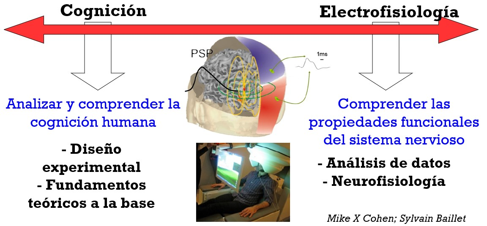
```

- Se describe un **espectro de investigadores con distintos objetivos**:
  - En un extremo, el interés principal es **comprender los procesos cognitivos.** La electrofisiología permite distinguir procesos y subcomponentes que las medidas conductuales pueden no diferenciar. Se priorizan el diseño experimental y las teorías cognitivas.
  - En el otro extremo, el interés principal es **comprender las propiedades funcionales de las redes neuronales.** Los paradigmas cognitivos sirven para provocar patrones específicos de actividad neuronal. Se priorizan el análisis de las señales y su interpretación neurofisiológica.


## ¿Qué se registra con EEG?

**El EEG registra diferencias de potencial eléctrico, habitualmente expresadas en microvoltios (µV).**

```{r, echo=FALSE, out.width='80%', fig.align='center', fig.cap=NULL}
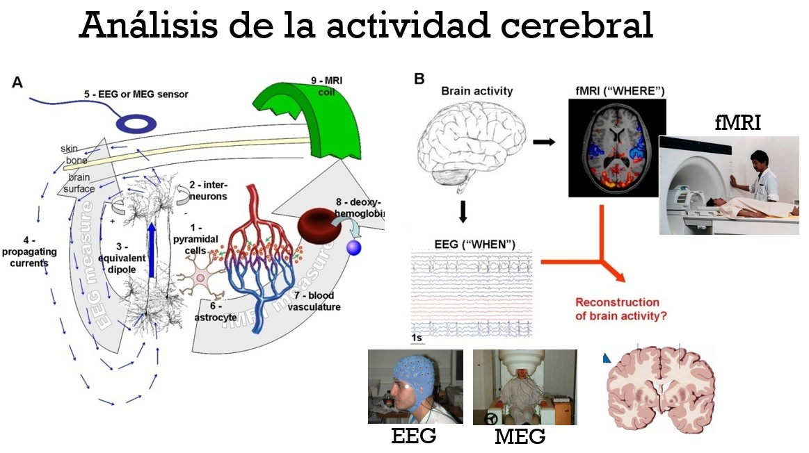
```

- El voltaje de cada electrodo se mide respecto de una **referencia**.
- La señal refleja actividad eléctrica de poblaciones neuronales, principalmente células piramidales corticales.
    - Cuando muchas neuronas están activas de manera sincronizada, sus pequeños campos eléctricos pueden sumarse y detectarse desde el cuero cabelludo.
    - La actividad de poblaciones pequeñas, poco sincronizadas o con orientaciones que producen cancelación puede ser difícil o imposible de registrar.
- **Un electrodo recibe contribuciones de varias fuentes cerebrales, y una fuente puede contribuir a varios electrodos.**

- Hay varias técnicas relacionadas.

| Técnica | ¿Qué mide y desde dónde? |
|:--|:--|
| EEG | Actividad eléctrica mediante electrodos en el cuero cabelludo. |
| MEG | Actividad magnética mediante sensores externos sobre la cabeza. |
| ECoG | Actividad eléctrica mediante electrodos colocados sobre la superficie cortical. |

**EEG**: Electroencefalograma. Mide actividad eléctrica desde electrodos ubicados en el cuero cabelludo.
```{r, echo=FALSE, out.width='50%', fig.align='center', fig.cap=NULL}
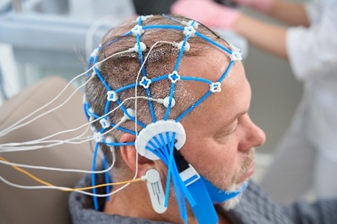
```

El EEG vs la MEG
```{r, echo=FALSE, out.width='90%', fig.align='center', fig.cap=NULL}
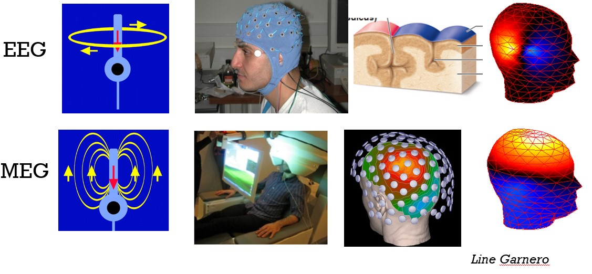
```

## ¿Para qué usar el EEG?

**El EEG resulta especialmente útil cuando importa cómo cambia la actividad cerebral en el tiempo.**

```{r, echo=FALSE, out.width='80%', fig.align='center', fig.cap=NULL}
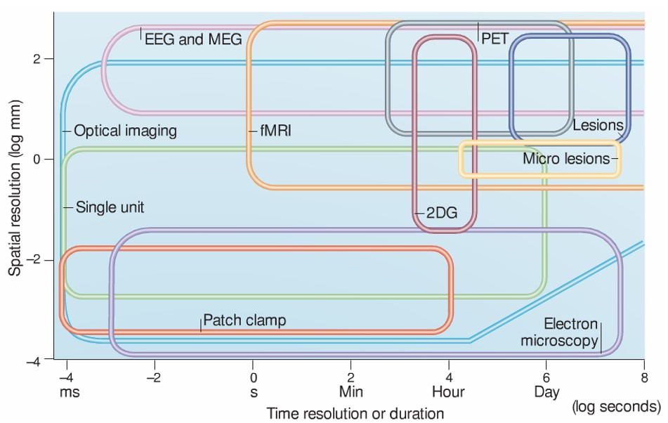
```

Hay 3 ventajas principales:

- **Permite estudiar la cognición en la escala temporal en que ocurre.** Los procesos perceptivos, cognitivos y motores se desarrollan en decenas o cientos de milisegundos. El EEG permite seguir esos cambios rápidos y su secuencia temporal.

- **Mide directamente la actividad eléctrica de poblaciones neuronales.** Las fluctuaciones de voltaje reflejan fenómenos biofísicos neuronales, a diferencia de medidas como la señal BOLD, que registra cambios hemodinámicos relacionados con esa actividad.

- **Proporciona una señal multidimensional.** Podemos estudiar cuándo ocurre la actividad, cómo se distribuye entre electrodos y cuáles son sus características de frecuencia, potencia y fase.
    - Esto permite formular hipótesis basadas tanto en procesos cognitivos como en mecanismos neurofisiológicos.
    - También permite relacionar registros no invasivos en humanos con registros invasivos en animales y modelos de actividad neuronal.
    
## ¿Cuándo no es adecuado?

- **Cuando la pregunta requiere una localización anatómica precisa.** El EEG es poco adecuado para determinar exactamente dónde ocurre un proceso o para estudiar estructuras cerebrales profundas.

- **Cuando los procesos cognitivos son lentos y tienen un curso temporal incierto y variable.** Si un proceso se desarrolla durante varios segundos y ocurre en momentos distintos en cada ensayo, resulta difícil relacionar sus cambios con la señal EEG.

## ERPs

**Los potenciales relacionados a eventos (ERPs) son respuestas eléctrica promedio alineadas a un evento.**

```{r, echo=FALSE, out.width='80%', fig.align='center', fig.cap=NULL}
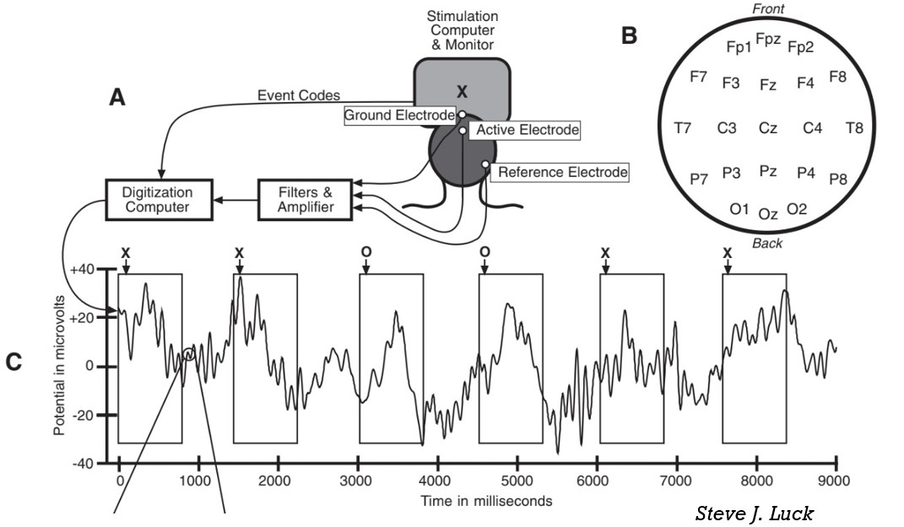
```

```{r, echo=FALSE, out.width='80%', fig.align='center', fig.cap=NULL}
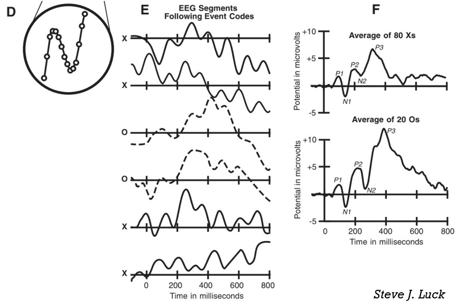
```

- Se recortan segmentos alrededor de un estímulo o una respuesta
- Se alinean en el tiempo y 
- Se promedian los voltaje
- El resultado permite examinar amplitudes y latencias: cuánto cambia el voltaje y cuándo ocurre ese cambio.

**RP**: El potencial de preparación señala la preparación de una respuesta motora.
```{r, echo=FALSE, out.width='70%', fig.align='center', fig.cap=NULL}
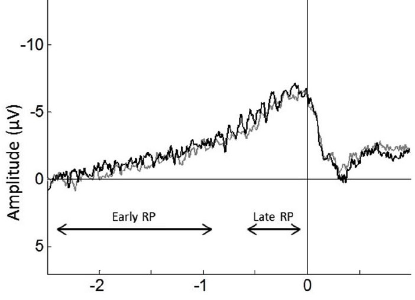
```

### Ventajas

- Son relativamente sencillos y rápidos de calcular.
- Conservan alta precisión temporal cuando el procesamiento introduce poco suavizado.
- Cuentan con una extensa tradición de resultados e hipótesis para orientar su interpretación.
- Permiten una primera revisión de la calidad de los datos y de la alineación de los eventos.

### Limitaciones

- El promedio puede cancelar actividad relevante cuya fase varía entre ensayos.
- La variabilidad temporal de las respuestas puede ensanchar o reducir los componentes.
- Una ausencia de diferencias en el ERP no implica ausencia de diferencias en el EEG.
- El ERP por sí solo no caracteriza todas las dinámicas de las redes, como las relaciones de fase entre frecuencias o regiones.

```{r, echo=FALSE, out.width='70%', fig.align='center', fig.cap=NULL}
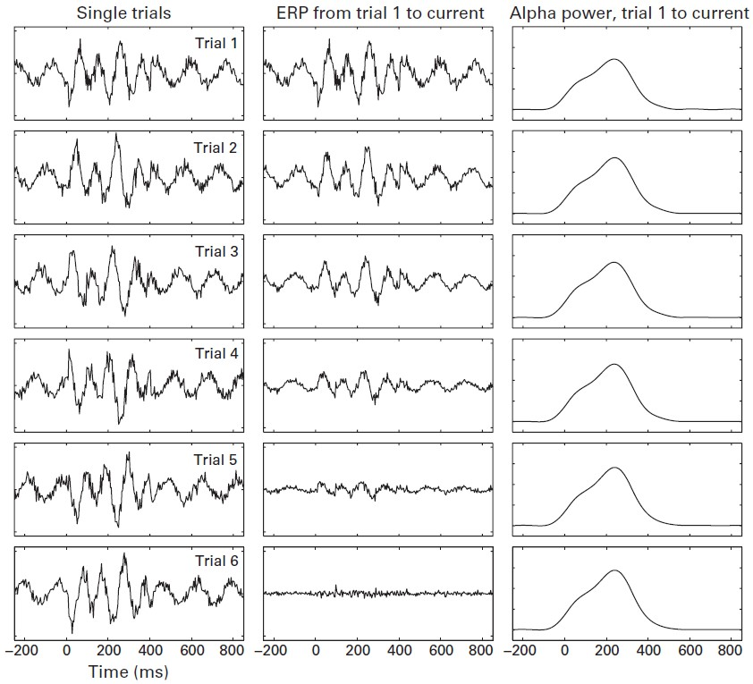
```

## Análisis TF

**Permite comprender cómo cambian, a lo largo del tiempo, propiedades de la señal como la potencia y la fase en distintas frecuencias.**

- En vez de describir únicamente el voltaje promedio, descompone la señal para estimar propiedades como potencia y fase. Así podemos preguntar, por ejemplo, si una condición cambia la potencia de una banda durante un período del ensayo.

```{r, echo=FALSE, out.width='50%', fig.align='center', fig.cap=NULL}
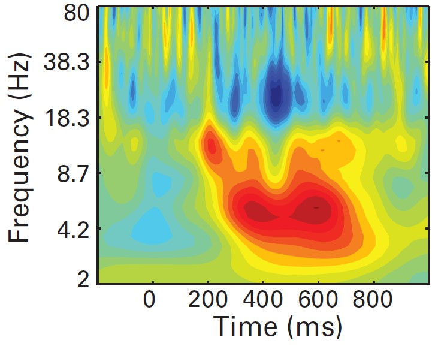
```

### Ventajas

- Recupera cambios de potencia que pueden desaparecer en el ERP por diferencias de fase entre ensayos.
- Distingue dinámicas que coexisten en distintas frecuencias.
- Permite plantear hipótesis sobre mecanismos oscilatorios y vincular resultados entre escalas de registro y especies.

### Limitaciones

- Introduce suavizado: se pierde precisión temporal respecto de una señal sin filtrar.
- Exige elegir parámetros; esos parámetros influyen en la apariencia y delimitación de los efectos.
- Multiplica las comparaciones entre tiempos, frecuencias y electrodos.
- Una representación tiempo-frecuencia no demuestra, por sí sola, que exista una oscilación neuronal.

**ERP y TF son complementarios.** La elección depende de la pregunta, no de que un análisis sea universalmente superior.

## Conceptos importantes

**Son propiedades distintas.** Piensen en una diana:

- El número de puntos representa la resolución (densidad de muestreo)
- Su dispersión, la precisión (incertidumbre en la medición)
- Su distancia al centro, la exactitud (correspondencia con el fénomeno que la genera)

```{r, echo=FALSE, out.width='40%', fig.align='center', fig.cap=NULL}
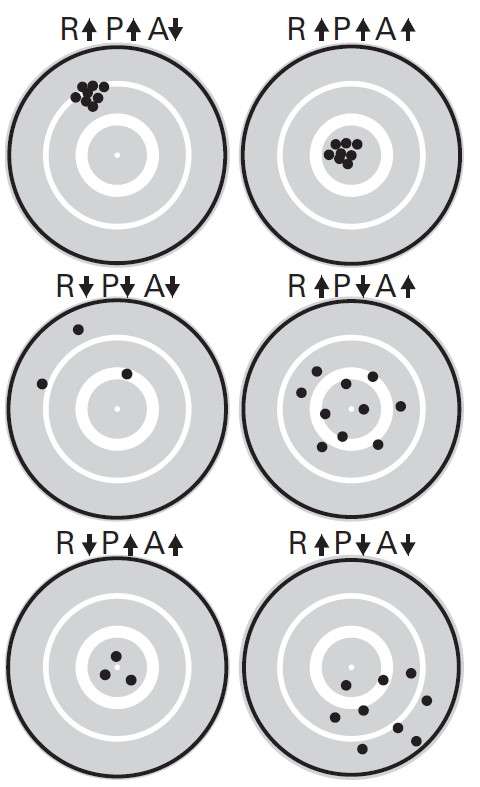
```

### En el tiempo

- **Resolución temporal:** cantidad de muestras registradas por unidad de tiempo.
    - Depende de la frecuencia de muestreo. Por ejemplo, 1000 Hz significa una muestra cada milisegundo.

- **Precisión temporal:** grado de incertidumbre sobre el momento al que corresponde la actividad estimada.
    - Depende del análisis. Los filtros y la descomposición tiempo-frecuencia combinan información de momentos vecinos.
    - Tener un resultado en cada milisegundo no significa que cada resultado refleje exclusivamente lo ocurrido en ese milisegundo.

- **Exactitud temporal:** correspondencia entre el momento de la actividad neuronal y el momento de su medición eléctrica.
    - Es muy alta porque los campos eléctricos llegan a los electrodos prácticamente de manera instantánea a la escala del registro.

### En el espacio

- **Resolución espacial:** en la terminología de Cohen, depende del número de electrodos que muestrean el cuero cabelludo.
    - Más electrodos aportan más puntos de medición; su utilidad depende de la pregunta y del análisis.

- **Precisión espacial:** qué tan localizada puede quedar la actividad estimada.
    - Es relativamente baja en el EEG, aunque puede mejorar mediante filtros espaciales y métodos de reconstrucción de fuentes.

- **Exactitud espacial:** correspondencia entre la localización atribuida a la actividad y su origen cerebral real.
    - Es limitada porque un electrodo recoge una mezcla de contribuciones de regiones próximas y distantes.
    - La anatomía, la orientación de las fuentes y su actividad influyen en esa mezcla.

**Aumentar el número de electrodos no convierte cada canal en una medición independiente de la región cerebral situada debajo.**


Brevemente:

| Concepto | En el tiempo | En el espacio |
|:--|:--|:--|
| **Resolución** | Cuántas muestras se registran por segundo. | Cuántas posiciones se muestrean mediante electrodos. |
| **Precisión** | Cuán acotada es la estimación temporal; disminuye con el suavizado. | Cuán delimitada es la información espacial; las fuentes se mezclan entre canales. |
| **Exactitud** | Correspondencia entre el momento de la actividad neuronal y su medición. | Correspondencia entre una localización estimada y la fuente cerebral real. |


## Topografías

**Son mapas de la distribución de una medida entre los electrodos del cuero cabelludo.**

- Pueden representar voltaje en un momento determinado o potencia en una frecuencia y ventana temporal seleccionadas.
- Para interpretarlas, hay que identificar qué medida muestran, qué intervalo resumen y qué representa la escala de color.

```{r, echo=FALSE, out.width='90%', fig.align='center', fig.cap=NULL}
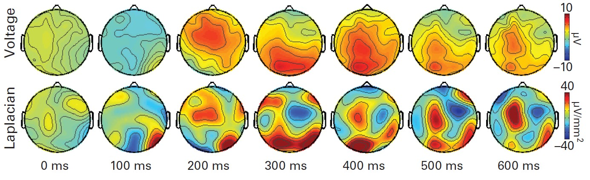
```

### Localización topográfica y localización cerebral

- **Localización topográfica:** identifica los electrodos donde el efecto es máximo.
    - Por ejemplo, señalar que una negatividad relacionada con el error es máxima en Cz o FCz describe dónde se observa el efecto en el registro.

- **Localización cerebral:** identifica las regiones que generaron la actividad medida.
    - Requiere supuestos sobre la anatomía y las propiedades conductoras de los tejidos, además de modelos y análisis.
    - Es un problema con múltiples soluciones posibles: distintas configuraciones de fuentes pueden producir una distribución similar en el cuero cabelludo.

**La localización topográfica describe una observación; la localización cerebral implica una inferencia sobre sus generadores.**

## Lo que importa en TF

### Frecuencia, potencia y fase

- **Frecuencia:** número de ciclos por segundo, expresado en hercios (Hz).
    - Una oscilación de 10 Hz completa 10 ciclos por segundo.

- **Potencia:** cuadrado de la amplitud; expresa la magnitud de la actividad en una frecuencia o banda.

- **Fase:** posición dentro del ciclo en un momento determinado, expresada en grados o radianes.
    - Potencia y fase aportan información diferente. Cuando la potencia es muy baja, la fase resulta más difícil de estimar.

Las bandas agrupan rangos de frecuencias. Ej: theta está entre 4–8 Hz, alfa está entre 8–12 Hz y beta entre 15–30 Hz. Los límites no son exactos: pueden variar entre estudios y existen diferencias individuales en las frecuencias de máxima actividad.

| Propiedad | Pregunta | Ejemplo |
|:--|:--|:--|
| **Frecuencia** | ¿Qué tan rápido oscila? | 10 Hz = 10 ciclos por segundo; cada ciclo dura 100 ms. |
| **Potencia** | ¿Qué magnitud tiene la actividad en esa frecuencia? | Se obtiene del cuadrado de la amplitud; duplicar la amplitud cuadruplica la potencia. |
| **Fase** | ¿En qué punto del ciclo está? | Dos señales pueden tener igual potencia, pero una estar en su cresta mientras la otra está en su valle. |

### Compromiso entre precisión temporal y frecuencial

**Mejorar la precisión en el tiempo suele reducir la precisión en frecuencia, y viceversa.**

- Para distinguir frecuencias cercanas se necesita información de un intervalo temporal más amplio.
- Para seguir cambios muy breves hay que aceptar mayor incertidumbre sobre su frecuencia exacta.
- Cohen lo ilustra con una limitación concreta: 20 ms de EEG no bastan para caracterizar actividad de 5 Hz.
- Un resultado situado en un punto del mapa resume información de tiempos y frecuencias vecinos; no es una medición aislada de ese punto.

Para caracterizar una señal lenta necesitamos observarla durante más tiempo. Por ejemplo, un ciclo de 5 Hz dura 200 ms: un fragmento de 20 ms no basta para caracterizar esa oscilación.

Un valor mostrado en "10 Hz, 300 ms" resume información de frecuencias y tiempos vecinos. No es una medición aislada, exacta, de ese único punto.


### Los datos TF

Los datos se pueden organizar por **tiempo, frecuencia y electrodo**. Cada gráfico muestra una selección o un resumen de esas dimensiones:

- **Espectro:** potencia según frecuencia, resumida durante un período. No muestra cómo cambia dentro de ese período.
- **Curso temporal:** evolución de la actividad en una banda seleccionada. Aunque se parezca visualmente a un ERP, representa otra medida.
- **Topografía:** distribución entre electrodos en un punto o ventana tiempo-frecuencia.
- **Mapa tiempo-frecuencia:** tiempo en el eje horizontal, frecuencia en el vertical y una medida representada mediante colores.

```{r, echo=FALSE, out.width='75%', fig.align='center', fig.cap=NULL}
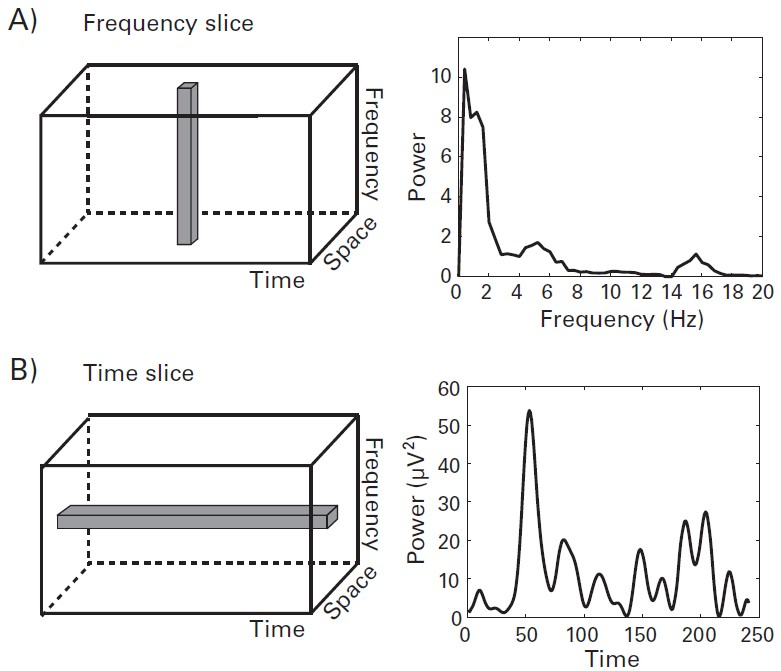
```

```{r, echo=FALSE, out.width='75%', fig.align='center', fig.cap=NULL}
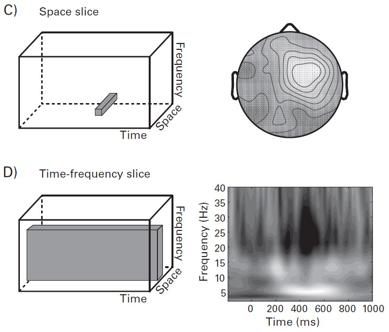
```

**El color no siempre representa potencia:** también puede mostrar consistencia de fase, conectividad o correlación con la conducta.

Brevemente:

| Vista | ¿Qué muestra? | ¿Qué se selecciona o resume? |
|:--|:--|:--|
| Espectro | Potencia según frecuencia. | Un período y uno o varios electrodos. |
| Curso temporal | Potencia según tiempo. | Una banda y uno o varios electrodos. |
| Topografía | Distribución entre electrodos. | Una banda y una ventana temporal. |
| Mapa tiempo-frecuencia | Cambios según tiempo y frecuencia. | Un electrodo o conjunto de electrodos. |


### Cómo leer un mapa tiempo-frecuencia

Puedes seguir 5 pasos:

1. **Identificar qué se representa.** Comprender la medida indicada en la leyenda: potencia, fase, conectividad u otra.
2. **Revisa ejes y escala.** ¿Qué significa tiempo cero? ¿Qué frecuencias se muestran? ¿Qué unidades tienen los colores? ¿Se expresa un cambio respecto de una línea base?
3. **Describir los resultados.** Identificar cuándo aparecen, cuánto duran, qué frecuencias abarcan y cómo se distribuyen entre electrodos. Revisar también el período previo al estímulo.
4. **Relacionarlos con el experimento.** Determinar qué significa tiempo cero y dónde ocurren los estímulos y respuestas. Preguntarse qué aportan los resultados a la comprensión del proceso estudiado.
5. **Examinar el respaldo estadístico.** Distinguir análisis guiados por hipótesis de análisis exploratorios; revisar cómo se eligieron las ventanas y cómo se abordaron las comparaciones múltiples.

La **línea base** es un período de referencia para expresar cambios. Una disminución respecto de ella no significa ausencia de actividad. Del mismo modo, un cambio respecto de la línea base no equivale automáticamente a una diferencia entre condiciones.

```{r, echo=FALSE, out.width='90%', fig.align='center', fig.cap=NULL}
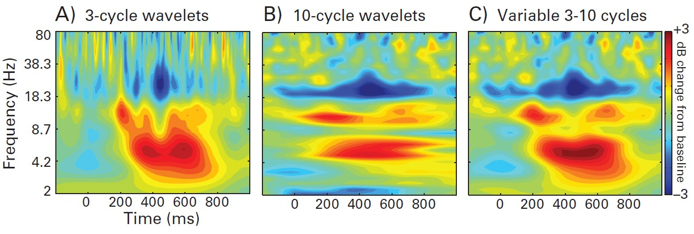
```


### ¿Qué patrones requieren especial atención?

- **Franjas horizontales o verticales:** pueden reflejar problemas de filtrado o efectos de borde.
- **Aumentos breves y muy intensos en altas frecuencias:** pueden deberse a artefactos, incluso presentes en un solo ensayo.
- **Cambios que abarcan muchas bandas:** pueden relacionarse con ruido mecánico o actividad muscular.
- **Variaciones de color extremadamente rápidas, especialmente en bajas frecuencias:** pueden indicar un problema de análisis o que se graficó otra propiedad de la señal en lugar de potencia.
- **Topografías extrañas con numerosos picos:** pueden reflejar electrodos ruidosos o errores en la correspondencia entre etiquetas y posiciones.
- **Frecuencias extremas:** por encima de 100 Hz, la baja relación señal/ruido exige especial cuidado; por debajo de 1 Hz, los filtros y las derivas lentas pueden afectar la interpretación.


## Del registro al análisis

**Entre registrar el EEG y responder una pregunta hay 2 etapas: preparar los datos y calcular las medidas que nos interesan.**

- **Preprocesamiento:** organizar los datos y reducir la influencia del ruido y los artefactos.
- **Análisis (procesamiento):** obtener medidas de actividad cerebral y utilizarlas para investigar una pregunta.

| Etapa | Pregunta principal | Ejemplo |
|:--|:--|:--|
| Preprocesamiento | ¿Los datos están preparados para el análisis? | Identificar ensayos contaminados por movimientos. |
| Análisis | ¿Qué información podemos extraer de estos datos? | Estimar cómo cambia la potencia alfa después de un estímulo. |

### Preprocesamiento

**Incluye las operaciones que realizamos entre la adquisición del EEG y su análisis.**

Estas operaciones pueden:

- **Organizar los datos**, sin modificar los valores de la señal.
    - Ej: segmentar el registro continuo en épocas alrededor de un estímulo.
- **Excluir datos de mala calidad.**
    - Ej: rechazar un ensayo con un artefacto intenso.
- **Transformar la señal.**
    - Ej: aplicar un filtro o cambiar la referencia.

**Nuestro objetivo es reducir el ruido conservando la actividad de interés.** Como ambos pueden estar mezclados, una limpieza más intensa también puede eliminar señal relevante.

### ¿Qué operaciones incluye?

**La secuencia depende del registro, del experimento y del análisis previsto.**

| Operación | ¿Para qué sirve? |
|:--|:--|
| **Importar y revisar el registro** | Comprobar la señal y varios parámetros (canales, frecuencia de muestreo ...). |
| **Incorporar las posiciones de los electrodos** | Relacionar cada canal con su ubicación para representar topografías y realizar análisis espaciales. |
| **Revisar los triggers** | Identificar correctamente los estímulos, las respuestas y las condiciones del experimento. |
| **Filtrar** | Atenuar determinadas frecuencias, como las derivas muy lentas o el ruido eléctrico. |
| **Revisar los canales auxiliares** | Utilizar señales oculares, cardíacas o musculares para reconocer posibles artefactos. |
| **Crear épocas** | Recortar segmentos alrededor de eventos y definir qué corresponde al tiempo cero. |
| **Corregir por línea base** | Restar, para cada canal y época, el voltaje promedio de un período de referencia a todos los puntos de esa época. El promedio del período de referencia queda en cero. |
| **Detectar canales y ensayos problemáticos** | Identificar datos que requieren exclusión o tratamiento adicional. |
| **Cambiar la referencia** | Expresar el voltaje de los canales respecto de una referencia seleccionada. |
| **Aplicar ICA, cuando corresponda** | Separar componentes e identificar aquellos asociados con artefactos para retirarlos de la reconstrucción de la señal. |
| **Interpolar canales, cuando corresponda** | Estimar la señal de un canal defectuoso a partir de otros electrodos y sus posiciones. |

- **Filtrar no elimina todos los artefactos.** La actividad muscular y cerebral puede compartir frecuencias.
- **ICA requiere interpretar los componentes.** No todo componente es un artefacto ni corresponde a una única fuente cerebral.
- **Interpolar no recupera una medición perdida.** Produce una estimación basada en los canales disponibles.
- **Para TF se necesitan márgenes temporales adicionales.** Conviene conservar datos antes y después del intervalo de interés para limitar la influencia de los efectos de borde.

### Análisis

**Con los datos preparados, calculamos las medidas que permiten abordar nuestra pregunta.**

- **ERPs:** promediar el voltaje de los ensayos alineados a un evento.
    - ¿Cuándo aparece una respuesta y cuál es su amplitud?
- **Potencia TF:** estimar cómo cambia la magnitud de la actividad en distintas frecuencias.
    - ¿Disminuye la potencia alfa después del estímulo?
- **Consistencia de fase entre ensayos:** evaluar si la fase se repite en un momento respecto del evento.
    - ¿La fase de una frecuencia es similar entre ensayos?
- **Conectividad:** cuantificar relaciones entre las señales de distintos sitios.
    - ¿Mantienen una diferencia de fase consistente o covarían sus potencias?

Estas medidas pueden compararse entre condiciones o relacionarse con la conducta.

### Un ejemplo completo

**Pregunta: ¿cambia la potencia alfa después de presentar un estímulo visual?**

1. **Registro:** adquirir el EEG y los marcadores que indican cuándo apareció cada estímulo.
2. **Preprocesamiento:** revisar los canales y eventos, tratar los artefactos y extraer épocas con márgenes suficientes.
3. **Analisis:** calcular la potencia TF de cada ensayo y expresar sus cambios respecto de una línea base.
4. **Estadística:** examinar cuándo y dónde aparece el cambio y realizar el contraste estadístico correspondiente.

### Lo importante

- **El preprocesamiento puede consumir mucho tiempo**, pero determina la calidad de los análisis posteriores.
- **Una misma preparación puede servir para varios análisis**, siempre que conserve la información necesaria para cada uno.
- **Las decisiones deben quedar registradas:** filtros, referencia, ensayos excluidos, canales interpolados y componentes retirados.
- **Deben aplicarse procedimientos y criterios consistentes entre condiciones**, para evitar introducir diferencias artificiales.
- **Un análisis sofisticado no compensa un registro de mala calidad.**

El análisis puede estar guiado por hipótesis o ser exploratorio. En ambos casos, debemos distinguir lo que estaba previsto de lo que surgió al examinar los datos.
