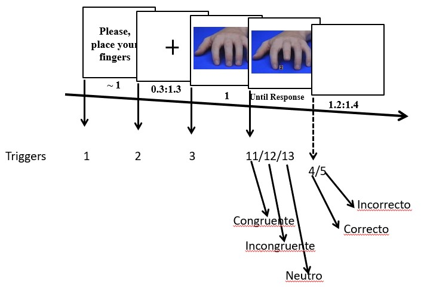
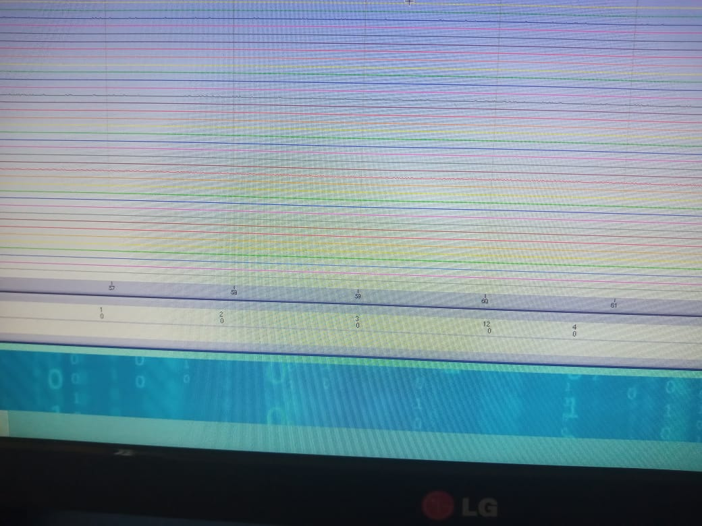
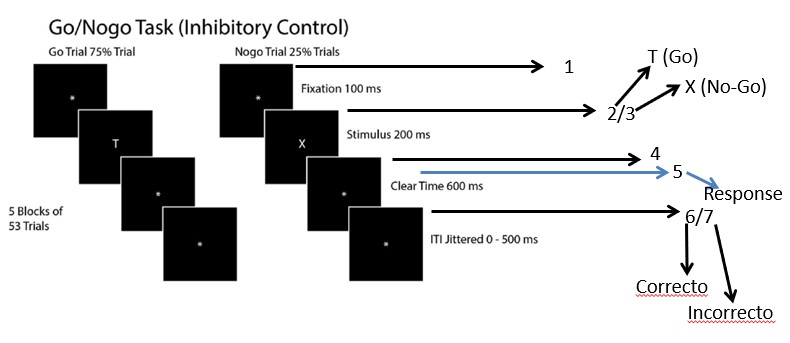
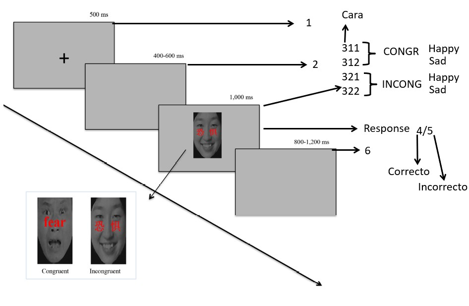
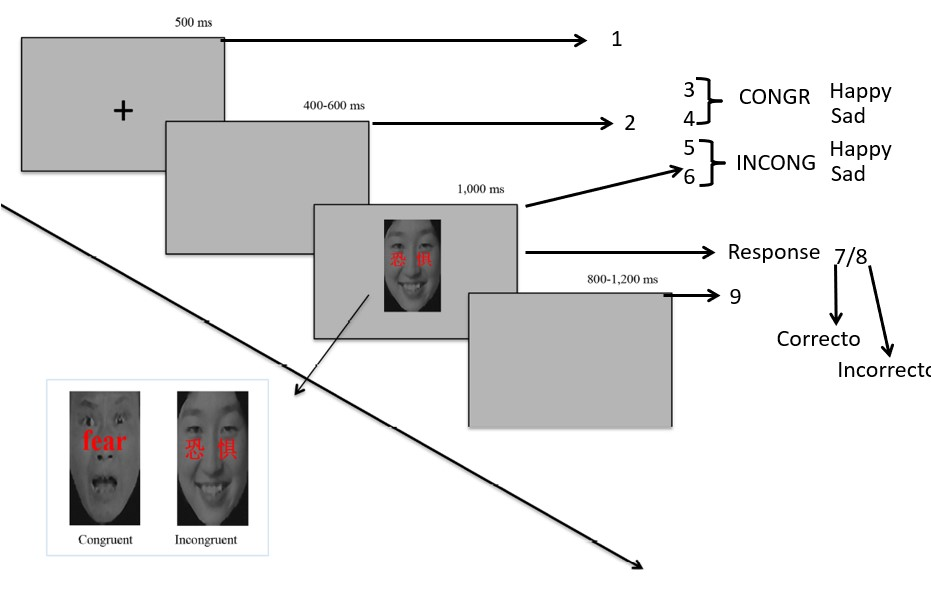
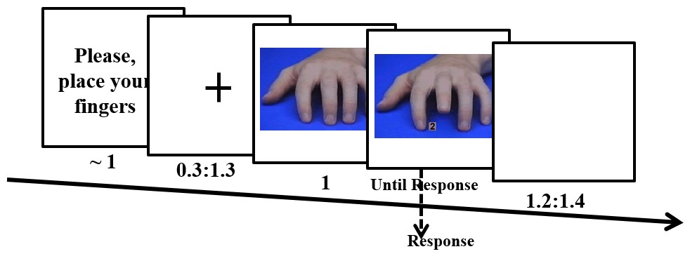
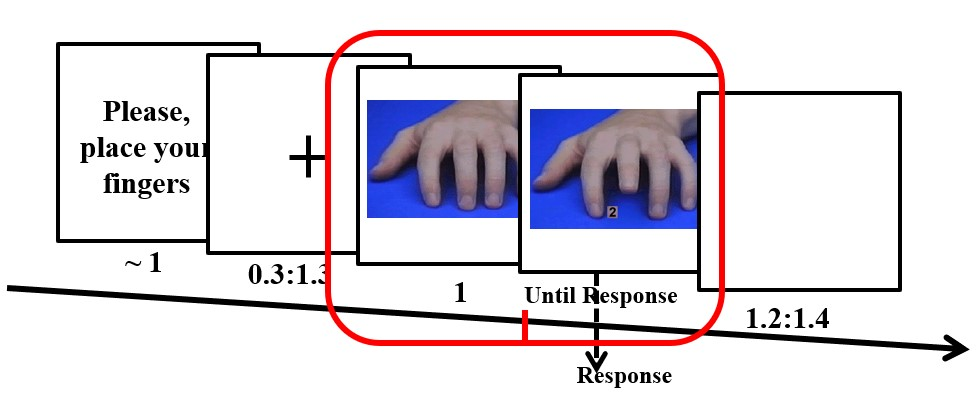
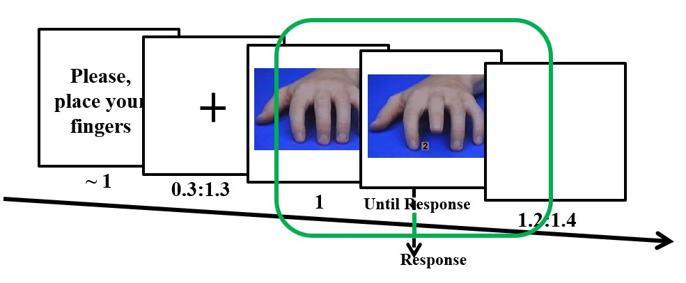

# Preprocesamiento del EEG

## ¿Qué es?

**El preprocesamiento comprende las transformaciones y reorganizaciones que hacemos de los datos crudos.**

- Algunas operaciones **organizan** los datos: recortar épocas alrededor de un evento.
- Otras **eliminan** datos contaminados: rechazar ensayos o retirar electrodos defectuosos.
- Otras **transforman** la señal: filtrar, cambiar la referencia o retirar componentes mediante ICA.

**No hay una receta única.** Las decisiones dependen del experimento, del equipo y de los análisis que queremos realizar.

- Debes aplicar los mismos procedimientos a las distintas condiciones. Evita que haya diferencias introducidas por el procesamiento!
- Registra las decisiones que hiciste para cada parte de tu pre-procesamiento (ensayos rechazados, electrodos interpolados y componentes retirados). Esto te permmite reproducir tu análisis.

## Antes de registrar

**Un buen análisis no compensa un experimento mal diseñado.**

- Discute el diseño y pide a otras personas que realicen la tarea.
- Pilotea tu tarea y chequea los resultados conductuales. Comprueba que la tarea funciona como se espera.
- Registra EEG de 1 o 2 participantes y realiza un análisis completo, testeando las hipótesis principales.
- Corrige los problemas antes de comenzar la recolección definitiva.

### Triggers

**Los marcadores o triggers indican cuándo ocurrió cada evento y permiten relacionarlo con el EEG.**

- Deben permitir identificar estímulos, condiciones y respuestas.
- Es más fácil agrupar códigos durante el análisis que reconstruir información que nunca se registró.
- Hay que comprobar que los códigos y sus tiempos se recuperan correctamente del archivo EEG.
    - Un marcador demasiado breve puede no ser detectado por el sistema.
    - Marcadores demasiado largos o simultáneos pueden superponerse y perderse.

**Sin marcadores correctos, podemos alinear la señal al evento equivocado o asignar ensayos a condiciones incorrectas.**

Tarea de imitación-inhibición (esquema de triggers)
```{r, echo=FALSE, out.width='75%', fig.align='center', fig.cap=NULL}

```

Tarea de imitación-inhibición (triggers en el registro)
```{r, echo=FALSE, out.width='100%', fig.align='center', fig.cap=NULL}

```

Tarea Go/No-Go (esquema de triggers)
```{r, echo=FALSE, out.width='90%', fig.align='center', fig.cap=NULL}

```

Tarea de Stroop emocional (esquema de triggers, versión 1)
```{r, echo=FALSE, out.width='90%', fig.align='center', fig.cap=NULL}

```

Tarea de Stroop emocional (esquema de triggers, versión 2)
```{r, echo=FALSE, out.width='90%', fig.align='center', fig.cap=NULL}

```

### Tiempos del experimento

- Hay que considerar que la respuesta cerebral a un evento puede continuar después de que el estímulo termine
- El análisis TF utiliza un intervalo de señal alrededor de cada instante para estimar la actividad. Por eso, una respuesta breve puede aparecer más extendida en el tiempo y resulta más difícil precisar cuándo comienza y termina.
- Si los eventos están muy próximos, sus respuestas pueden superponerse.
- Conviene pilotear con intervalos amplios cuando no sabemos cuánto dura la respuesta de interés.

- El intervalo entre ensayos debe considerar la **línea base** y las **frecuencias que se analizarán**.
    - En TF, el suavizado puede extender actividad posterior al estímulo hacia el período previo.
    - Es bueno separar la línea base del inicio del estímulo. Ej: usar −500 a −200 ms.
    
Tarea de imitación-inhibición
```{r, echo=FALSE, out.width='90%', fig.align='center', fig.cap=NULL}

```

- Los intervalos fijos y variables tienen consecuencias:
    - **Intervalos fijos:** permiten anticipar el siguiente ensayo y prepararse.
    - **Intervalos variables:** también generan expectativas temporales, que cambian según cuánto se ha esperado.

### Ensayos, electrodos y muestreo

- **Número de ensayos:** depende de la relación señal/ruido, el tamaño del efecto y el análisis.
    - Se ha propuesto que alrededor de 50 ensayos por condición y participante está OK.

- **Número de electrodos:** depende de las inferencias que queremos hacer.
    - Una medición ERP localizada requiere menos cobertura que una reconstrucción de fuentes.
    - Tener al menos 64 electrodos cuando sea posible es un buen compromiso.

- **Frecuencia de muestreo:** debe permitir representar las frecuencias de interés.
    - Solo pueden recuperarse frecuencias por debajo de la mitad de la frecuencia de muestreo.
    - En la práctica, se recomienda muestrear por encima de ese mínimo, especialmente para estimar fase.
    - Para muchos análisis un rango útil es 500–2000 Hz (más alto > mayor tamaño de los archivos y tiempo de procesamiento).

## Epoquear

**Una época es un segmento del EEG continuo recortado alrededor de un evento.**

- Antes de segmentar: datos organizados por **electrodo × tiempo**.
- Después de segmentar: datos organizados por **electrodo × tiempo × ensayo**.

### El tiempo 0

- Puede ser el inicio del estímulo, una respuesta u otro evento de interés.
- La elección debe corresponder a la pregunta que queremos responder.
- Si interesa tanto el estímulo como la respuesta, deben conservarse ambos eventos y suficiente señal alrededor de ellos.
- Los datos pueden realinearse durante el análisis si esos eventos y períodos están incluidos en las épocas.

Tarea de imitación-inhibición (epoqueado al comienzo del estímulo)
```{r, echo=FALSE, out.width='90%', fig.align='center', fig.cap=NULL}

```

Tarea de imitación-inhibición (epoqueado al comienzo de la respuesta)
```{r, echo=FALSE, out.width='90%', fig.align='center', fig.cap=NULL}

```

En reposo no es necesario alinear los datos a estímulos, pero se pueden dividir en segmentos de varios segundos para facilitar el análisis.

### Efectos de borde

**Para TF necesitamos más señal que la ventana que finalmente queremos interpretar.**

- Los extremos de una época introducen discontinuidades que pueden generar **efectos de borde** al aplicar filtros o descomposición TF.
- Por eso se incluyen márgenes temporales antes y después del período de interés.
- Esos márgenes se descartan después de la descomposición.
- Las frecuencias bajas requieren márgenes más largos.

Ejemplos:

- Para analizar de 0 a 1000 ms, se podrían extraer épocas de −1500 a +2500 ms.
- Una formula es usar 3 ciclos de la frecuencia más baja como orientación inicial: a 2 Hz, tres ciclos duran 1500 ms.
- El margen necesario depende del método y de la magnitud de las discontinuidades; hay que revisar los resultados.

## Número de ensayos

**Una diferencia en el número de ensayos (trials) puede afectar las estimaciones y su comparabilidad.**

- Las medidas basadas en fase son especialmente sensibles: pocos ensayos pueden introducir un sesgo positivo.
- En los ERPs, pocos ensayos reducen la relación señal/ruido y aumentan la influencia de valores extremos.
- Diferencias pequeñas, como 84 frente a 87 ensayos, no plantean el mismo problema que 84 frente a 23.

## Filtros temporal

**Los filtros atenúan determinados rangos de frecuencia y modifican la señal.**

| Filtro | ¿Qué atenúa? |
|:--|:--|
| High-pass | Fluctuaciones lentas por debajo del rango que se conserva. |
| Low-pass | Actividad rápida por encima del rango que se conserva. |
| Notch | Una banda estrecha, por ejemplo alrededor de 50 o 60 Hz. |

- La elección depende de las frecuencias y procesos que queremos estudiar.
- Se ha propuesto un high-pass de 0.1 o 0.5 Hz para reducir derivas lentas, aplicados sobre datos continuos.
    - Aplicarlos a épocas cortas puede introducir efectos de borde que ocupen gran parte de la época.
- Muchos métodos TF ya realizan un filtrado por frecuencias.
    - Si solo extraeremos actividad entre 2 y 20 Hz, un low-pass previo a 40 Hz no es necesario.

**Filtrar más no significa limpiar mejor.** Un filtro puede eliminar actividad de interés, reducir la precisión temporal o introducir oscilaciones artificiales.

## Rechazo de artefactos

**Se eliminan ensayos cuya contaminación impide utilizarlos adecuadamente en el análisis.**

- Algunos rechazos son claros; otros dependen del balance entre conservar señal y reducir ruido.
- Hay dos enfoques principales:
    - **Inspección visual:** permite examinar patrones que un criterio automático podría pasar por alto, pero depende del juicio del investigador.
    - **Rechazo automático:** es rápido y reproducible, pero puede descartar ensayos válidos o conservar artefactos si los criterios no se ajustan a los datos.
- Cohen expresa su preferencia por la inspección visual; no la presenta como una solución universal.

**En TF, las discontinuidades bruscas merecen especial atención:** incluso un salto pequeño puede producir efectos importantes al descomponer la señal.

## Referencia

**Todos los voltajes EEG se expresan respecto de una referencia.**

- La actividad presente en la referencia se refleja en los otros canales.
- Una referencia ruidosa puede contaminar todo el registro.
- Entre las opciones existe: promedio de mastoides, el promedio de lóbulos de las orejas y la referencia promedio.
- Ninguna referencia es eléctricamente neutra ni adecuada para todas las preguntas.

### ¿Qué considerar?

- El número y la distribución de electrodos.
- Los análisis y la localización esperada de los efectos.
- Evitar que la referencia esté cerca del efecto principal: por ejemplo, Cz puede ser una mala elección si interesa una respuesta máxima en Cz o FCz.
- Una referencia unilateral puede introducir asimetrías en los datos.

La referencia puede cambiarse después del registro. Aun así, hay que conocer cuál se utilizó durante la adquisición y comprobar su calidad.

## Electrodos defectuosos

**Interpolar consiste en estimar la señal de un electrodo a partir de otros electrodos y sus posiciones.**

- Puede ser necesario cuando un canal está plano o registra principalmente ruido.
- Antes de interpolar, hay que comprobar si contiene señal cerebral recuperable.
- Si el problema se detecta durante el registro, es preferible corregirlo en ese momento.

### ¿Qué limitación tiene?

- La señal interpolada es una estimación derivada de otros canales.
- No aporta información independiente y no recupera exactamente lo que habría registrado el electrodo.
- La interpolación introduce dependencias entre canales y puede afectar análisis que requieren una matriz de rango completo.

**Un electrodo defectuoso no debe entrar sin revisión en operaciones que combinan canales**, como la referencia promedio o ciertos filtros espaciales: su ruido puede propagarse a los demás.

## Filtrado espacial

**Combina información de distintos electrodos para modificar cómo se representa espacialmente la actividad.**

Cohen distingue tres objetivos:

- **Ayudar a localizar un resultado.** Por ejemplo, evaluar si una respuesta es compatible con una fuente motora.
- **Separar patrones que se superponen en el cuero cabelludo.** Por ejemplo, respuestas occipitales y parietales.
- **Reducir efectos de conducción de volumen en algunos análisis de conectividad.** Una misma fuente puede contribuir a varios electrodos y generar asociaciones que no reflejan interacción entre fuentes diferentes.

- Entre los métodos discutidos están el Laplaciano de superficie y la reconstrucción de fuentes.
- No todos los filtros espaciales resuelven los mismos problemas ni se aplican en la misma etapa.
- Por ejemplo, el Laplaciano utilizado antes de estimar conectividad se aplica a la señal temporal de los ensayos, antes de la descomposición TF.

## Artefactos e ICA

**ICA es una técnica que descompone la señal en componentes intentando separar fuentes estadísticamente independientes.**

- Cada componente es una combinación ponderada de los electrodos.
- Puede utilizarse para identificar componentes dominados por artefactos y retirar su contribución de los datos.
- También puede utilizarse para analizar directamente la actividad de los componentes.

### Componentes artefactuales

Se consideran conjuntamente:

- **Topografía:** cómo se distribuyen sus pesos entre electrodos.
- **Curso temporal:** cuándo aparecen sus variaciones y qué forma tienen.
- **Espectro:** en qué frecuencias se concentra su actividad.

Ej: un componente de parpadeo suele mostrar una distribución anterior y deflexiones grandes y breves en el tiempo.

### Limitaciones

- ICA se basa en propiedades estadísticas: **no sabe qué es señal cerebral y qué es ruido**.
- Un componente puede contener ambos.
- La ausencia de un ERP en un componente no demuestra que carezca de señal cerebral: podría contener actividad no ligada a la fase.
- Cohen propone retirar componentes solo cuando existe evidencia convincente de artefacto y poca o ninguna señal de interés.

**Eliminar componentes de forma indiscriminada puede eliminar actividad cerebral.**

## Parpadeos

**Corregir el artefacto eléctrico no garantiza que el ensayo sea válido para la pregunta experimental.**

- El artefacto del parpadeo se superpone a la señal cerebral y puede atenuarse mediante ICA u otros métodos.
- Sin embargo, un parpadeo durante un estímulo visual breve puede impedir que la persona lo vea.
- Un cierre prolongado de los ojos también puede indicar fatiga o falta de atención.
- La decisión de conservar el ensayo debe considerar el momento y la duración del parpadeo.

### ¿Pedir que no parpadeen?

- Suprimir activamente los parpadeos puede exigir esfuerzo y distraer de la tarea.
- Concentrarlos en el intervalo entre ensayos puede contaminar la línea base.
- Pedir que parpadeen siempre al responder puede hacer que el parpadeo y la actividad de respuesta estén ligados temporalmente, dificultando su separación mediante ICA.

## Movimientos oculares

- Sacadas y microsacadas también pueden contaminar el EEG.
- Los electrodos EOG permiten detectar movimientos relativamente grandes; un sistema de seguimiento ocular ofrece mayor sensibilidad para movimientos pequeños.
- Estímulos centrales y una fijación visible pueden ayudar a reducir movimientos innecesarios, según la tarea.
- El impacto depende de la referencia, los electrodos y las frecuencias analizadas.

**Si la tarea exige mantener la fijación, romperla puede invalidar un ensayo aunque se corrija el artefacto eléctrico.**

## Actividad muscular

**El EMG puede aparecer en los canales EEG y confundirse con actividad cerebral rápida.**

- Suele observarse como ráfagas rápidas, a menudo de gran amplitud y más marcadas cerca de cara, cuello y orejas.
- Es especialmente problemático para estudiar actividad beta y frecuencias superiores.
- Ráfagas intensas pueden acompañar movimientos, tos o tensión muscular y justificar el rechazo del ensayo.
- La contaminación continua exige valorar su distribución y los objetivos del análisis.
- Si se retira un componente muscular mediante ICA, hay que comprobar que no contenga también señal cerebral relevante.

### Errores parciales

- Una persona puede activar brevemente la mano incorrecta y después pulsar correctamente con la otra.
- El registro conductual indica acierto, pero el EMG permite detectar esa activación incorrecta.
- Esos ensayos pueden presentar respuestas cerebrales parecidas a las de los errores.
- Según la pregunta, pueden separarse o analizarse como una categoría propia.

## Un buen registro

**La mejor forma de facilitar el preprocesamiento es comenzar con datos de buena calidad.**

- Mostrar al participante su EEG en tiempo real.
- Pedirle que parpadee, tense la mandíbula o mueva los hombros para observar cómo cambia la señal.
- Explicar qué comportamientos producen artefactos y cómo reducirlos sin desatender la tarea.
- Vigilar la señal durante la adquisición.
- Si aparece un problema persistente, pausar cuando sea posible y corregir su causa.
- Comprobar comodidad, postura y fatiga.

**El preprocesamiento puede mejorar datos buenos; no convierte cualquier registro deficiente en datos de buena calidad.**

## Sanity-checks

**Los ERPs y las series de tiempo ayudan a comprobar la calidad de los datos, aunque el análisis principal sea TF.**

- **ERP por condición:** alinear los ensayos y promediar el voltaje en cada instante.
- **Butterfly plot:** superponer los ERPs de todos los electrodos para detectar canales o patrones anómalos.
- **Global field power:** desviación estándar entre electrodos en cada instante; describe la dispersión espacial de los voltajes y no equivale al voltaje promedio.
- **Topografías a lo largo del tiempo:** revisar la distribución de las respuestas y detectar electrodos problemáticos.
- **ERP image:** mostrar los ensayos de un electrodo como filas, con el voltaje representado por colores; permite observar información que se pierde en el promedio.

- Una curva más suave no es necesariamente una representación más fiel de los datos.

## Documentar

- Evento utilizado como tiempo cero, duración de las épocas y márgenes temporales.
- Filtros y parámetros aplicados.
- Referencia utilizada.
- Electrodos retirados o interpolados.
- Componentes retirados mediante ICA y criterios utilizados.
- Ensayos excluidos por artefactos o conducta.
- Cantidad final de ensayos por condición y cualquier procedimiento para igualarla.

**Estas decisiones deben permitir reconstruir el resultado a partir de los datos originales.**
