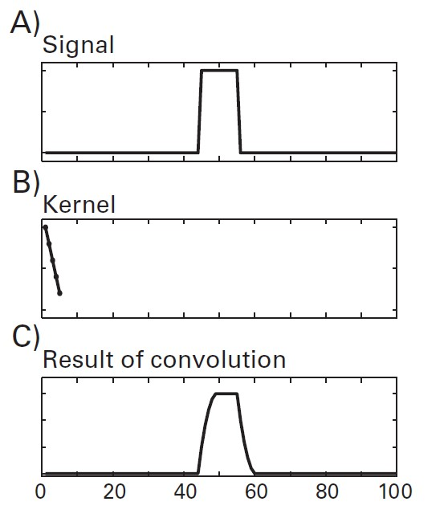

# Tiempo-frecuencia

## ¿Qué buscamos con TF?

**Separar la señal EEG en distintas frecuencias y estudiar cómo cambian su potencia y su fase en el tiempo.**

- Una misma señal puede contener actividad de varias frecuencias simultáneamente.
- La descomposición permite describir esas contribuciones.

## Producto punto

**El producto punto resulta de multiplicar los valores correspondientes de dos vectores y sumar los resultados.**

- Los vectores deben tener la misma cantidad de elementos.
- El resultado es un solo número.
- Puede entenderse como una suma ponderada o una medida de correspondencia entre dos patrones.

Ejemplo:

$$
[1,2,3]\cdot[2,0,1]=1\times2+2\times0+3\times1=5
$$

- En el análisis de señales, uno de los vectores puede ser un fragmento del EEG y el otro una onda conocida.
- El resultado depende de cuánto coinciden sus formas, de sus amplitudes y de su fase relativa.
- No es una correlación normalizada: no está limitado al rango de −1 a 1.

**Es una operación básica de la convolución y de la transformada de Fourier.**

## Convolución

**La convolución aplica repetidamente una función sobre la señal para obtener una nueva serie temporal.**

- Se utiliza una función llamada **kernel**, que puede ser una wavelet.
- Se invierte el kernel en el tiempo y se desplaza a lo largo de la señal.
- En cada posición se calcula un producto punto.
- Los resultados forman una nueva señal que cambia en el tiempo.

```{r, echo=FALSE, out.width='40%', fig.align='center', fig.cap=NULL}

```

Si el kernel es una wavelet de 10 Hz, el resultado permite seguir la contribución de la actividad alrededor de 10 Hz a lo largo del registro.

**Cada valor del resultado combina información de varios momentos vecinos.** Por eso, una respuesta breve puede aparecer más extendida en el tiempo y resulta más difícil precisar cuándo comienza y termina.

## Transformada de Fourier

**La transformada de Fourier describe qué componentes sinusoidales permiten reconstruir una señal.**

- Refleja la correspondencia de la señal con ondas de distintas frecuencias.
- Para cada frecuencia devuelve un coeficiente complejo que contiene información de amplitud y fase.
- La **FFT** es un algoritmo eficiente para calcular la transformada discreta de Fourier: se obtiene el mismo resultado con menos operaciones.

### ¿Qué nos dice y qué no?

- Aplicada a un segmento completo, describe su contenido frecuencial.
- No muestra directamente cómo cambia ese contenido dentro del segmento.
- Por ejemplo, si la actividad alfa aparece solo al final de un ensayo, el espectro del ensayo completo no muestra por sí solo ese momento de aparición.

### Duración y frecuencias

- Un segmento más largo permite distinguir frecuencias más cercanas.
- Añadir ceros antes de calcular la FFT produce más puntos en el espectro, pero no añade información ni permite resolver componentes que los datos originales no distinguen.
- La FFT también permite calcular convoluciones de forma eficiente: multiplicar las transformadas de la señal y del kernel y aplicar la transformada inversa, con la longitud adecuada para evitar que los extremos se mezclen.

## Wavelets de Morlet

**Una wavelet de Morlet combina una oscilación con una envolvente gaussiana que concentra su amplitud alrededor de un momento.**

- La oscilación define la frecuencia de interés.
- La envolvente hace que la onda sea breve, en vez de extenderse por toda la señal.
- Se convoluciona con el EEG y se repite el procedimiento para distintas frecuencias.
- Las wavelets complejas permiten obtener potencia y fase en cada instante.

### Número de ciclos

**El número de ciclos controla el compromiso entre precisión temporal y frecuencial.**

- **Menos ciclos:** la wavelet es más breve; permite localizar mejor cambios rápidos, pero distingue peor frecuencias cercanas.
- **Más ciclos:** la wavelet es más larga; distingue mejor las frecuencias, pero extiende más los cambios en el tiempo.
- Con el mismo número de ciclos, una wavelet de baja frecuencia dura más que una de alta frecuencia.

No hay un número de ciclos adecuado para todas las preguntas. Debe elegirse considerando la duración de los efectos y las frecuencias que queremos distinguir.

## FFT en ventanas cortas

**La short-time FFT calcula el espectro de pequeños segmentos que se desplazan a lo largo de la señal.**

1. Seleccionar una ventana temporal.
2. Aplicar una función que atenúe sus extremos, como una ventana de Hann.
3. Calcular la FFT de ese segmento.
4. Desplazar la ventana y repetir.

### ¿Qué se elige?

- **Duración de la ventana:**
    - Ventanas cortas permiten seguir cambios rápidos, pero distinguen peor frecuencias cercanas.
    - Ventanas largas distinguen mejor las frecuencias, pero pueden mezclar actividad de diferentes momentos.
- **Desplazamiento entre ventanas:** determina cuántos resultados se obtienen a lo largo del tiempo.
    - Ventanas muy superpuestas comparten gran parte de los datos; esos resultados no son observaciones independientes.
- **Función de atenuación:** reduce las discontinuidades en los extremos de cada segmento y la dispersión de su energía hacia otras frecuencias.

**El intervalo entre puntos del gráfico no equivale a la precisión temporal del análisis.** Calcular un resultado cada 10 ms usando ventanas de 500 ms sigue implicando que cada resultado resume un intervalo amplio.

## Multitaper

**El método multitaper permite analizar cada segmento utilizando varias funciones de atenuación (tapers) y combina sus estimaciones espectrales.**

- Se selecciona un segmento temporal.
- Se multiplica por varios tapers, habitualmente secuencias DPSS o Slepian.
- Se calcula una FFT para cada versión del segmento.
- Para estimar potencia, se promedian los espectros de potencia obtenidos.
- Al desplazar el segmento se construye una representación TF.

### Ventajas y límites

- Puede estabilizar las estimaciones frente al ruido, especialmente en análisis de ensayos individuales y de potencia en altas frecuencias.
- Exige elegir la duración de la ventana y cuánto suavizado frecuencial se acepta; estas decisiones determinan cuántos tapers son útiles.
- Más suavizado puede ocultar efectos próximos en tiempo o frecuencia.
- Cohen destaca su utilidad para altas frecuencias, pero advierte que puede ser menos adecuado para separar efectos de baja frecuencia cercanos entre sí o para precisar el momento de cambios rápidos.

Brevemente:

| Método | Operación principal | Decisión importante |
|:--|:--|:--|
| Morlet | Convolución con wavelets de distintas frecuencias. | Número de ciclos. |
| Short-time FFT | FFT de segmentos con una función de atenuación. | Duración y desplazamiento de la ventana. |
| Multitaper | Varias estimaciones espectrales del mismo segmento. | Duración y suavizado frecuencial. |

## Potencia y fase

**Un resultado complejo puede representarse como una flecha: su longitud indica amplitud y su ángulo indica fase.**

Si el resultado es $z=a+ib$:

- **Amplitud:** longitud de la flecha, $|z|=\sqrt{a^2+b^2}$.
- **Potencia:** amplitud al cuadrado, $|z|^2=a^2+b^2$.
- **Fase:** ángulo de la flecha, $\phi=\arg(z)$.

Potencia y fase describen propiedades diferentes, aunque cuando la señal tiene muy poca potencia respecto del ruido, su fase resulta difícil de estimar.

## Escala de potencia

**La potencia del EEG suele ser mayor en frecuencias bajas y menor en frecuencias altas.**

- Cohen describe esta tendencia mediante una relación de tipo $1/f$; su forma general incluye un exponente que puede variar.
- En un mapa de potencia sin normalizar, las frecuencias bajas pueden dominar la escala de color.
- También existen diferencias de amplitud entre electrodos y participantes.

La normalización respecto de una línea base permite expresar cuánto cambia cada frecuencia en relación con su propio nivel de referencia.

**Cambiar los límites de color solo cambia la presentación. Normalizar respecto de una línea base cambia la medida y su interpretación.**

## Línea base

**La línea base es el período de referencia con el que comparamos la potencia de otros momentos.**

- Primero se estima la potencia TF.
- Después se calcula la potencia media durante la línea base, por separado para cada frecuencia y canal.
- Cada valor se expresa respecto de ese nivel de referencia.

### Decibeles

$$
\mathrm{dB}(t,f)=10\log_{10}\left(\frac{P(t,f)}{B(f)}\right)
$$

$P(t,f)$ es la potencia en un tiempo y frecuencia; $B(f)$ es la potencia media de esa frecuencia durante la línea base.

- **0 dB:** misma potencia que en la línea base.
- **Valores positivos:** aumento relativo de potencia.
- **Valores negativos:** disminución relativa de potencia.

Ej:

| Potencia respecto de la línea base | Razón | Cambio porcentual | Decibeles |
|:--|:--|:--|:--|
| La mitad | 0,5 | −50% | Aproximadamente −3 dB. |
| La misma | 1 | 0% | 0 dB. |
| El doble | 2 | +100% | Aproximadamente +3 dB. |

**−3 dB no significa potencia negativa.** Significa que la potencia es aproximadamente la mitad del nivel de referencia.

### Otras transformaciones

- **Razón:** dividir la potencia por la potencia de la línea base. El valor sin cambio es 1.
- **Cambio porcentual:** $100\times(P-B)/B$. El valor sin cambio es 0%.
- **Puntuación z:** restar la media de la línea base y dividir por su desviación estándar. Expresa la distancia respecto de la línea base en unidades de su variabilidad.

No producen resultados idénticos: los decibelios utilizan una escala logarítmica; el porcentaje utiliza una escala lineal; la puntuación z también depende de la variabilidad de la línea base.

### ¿Cómo elegir el período?

- Revisar qué ocurrió antes del evento: un estímulo de advertencia o una respuesta previa pueden contaminar la referencia.
- Dejar suficiente separación respecto del evento para reducir la influencia de actividad posterior que se extienda hacia atrás por el análisis TF.
- No copiar automáticamente la línea base utilizada para un ERP.
- Si se estudia actividad alineada a la respuesta, una línea base inmediatamente anterior puede contener procesamiento del estímulo o preparación motora.

**La línea base no es un estado de ausencia de actividad cerebral.** Es una comparación elegida dentro del diseño.

### ¿Una línea base por condición o una común?

- **Por condición:** cada condición se compara con su propio nivel previo.
- **Común:** se calcula una referencia combinando las condiciones y se aplica a todas.
    - Utiliza más ensayos para estimar la referencia.
    - Permite conservar diferencias previas entre condiciones.

Una diferencia de línea base puede cambiar la interpretación de lo que ocurre después. Dos condiciones con la misma potencia posterior pueden mostrar cambios relativos distintos si partían de niveles diferentes.

## ITPC

**La ITPC indica qué tan parecida es la fase de un mismo canal, en un mismo tiempo y frecuencia, entre ensayos.**

ITPC significa *intertrial phase clustering*.

- Se alinean los ensayos a un evento.
- Se toma la fase de cada ensayo en un punto TF.
- Se examina si esas fases se concentran alrededor de un ángulo o están dispersas.

### ¿Por qué no promediar directamente los ángulos?

- La fase es circular: 0° y 360° representan el mismo punto.
- 10° y 350° están cerca, aunque su promedio aritmético sea 180°.
- Por eso se representan como flechas de longitud 1 en un círculo y se promedian las flechas.

### ¿Cómo se calcula?

$$
\mathrm{ITPC}(t,f)=\left|\frac{1}{N}\sum_{r=1}^{N}e^{i\phi_r(t,f)}\right|
$$

$N$ es el número de ensayos y $\phi_r$ la fase de cada ensayo. La expresión $e^{i\phi}$ representa una flecha de longitud 1; las barras indican la longitud de la flecha promedio.

- **Cerca de 1:** las flechas apuntan en direcciones similares; las fases son consistentes entre ensayos.
- **Cerca de 0:** las flechas se compensan y la resultante es pequeña.

Por ejemplo, fases de 20°, 25° y 30° producen alta ITPC. Fases repartidas alrededor de todo el círculo producen baja ITPC.

### ¿Qué debemos cuidar?

- Con pocos ensayos, la ITPC puede ser relativamente alta incluso con fases aleatorias.
- Diferencias de cantidad de ensayos entre condiciones pueden sesgar la comparación.
- La variabilidad en el tiempo de los eventos reduce la consistencia de fase, especialmente en frecuencias altas.
- Aunque la fórmula elimina la amplitud de cada flecha, una mala relación señal/ruido afecta la estimación de fase.
- Una ITPC baja no descarta toda estructura: dos grupos de fases en ángulos opuestos también pueden cancelarse.

**La ITPC mide consistencia respecto de un evento, no conectividad entre dos sitios.** Tampoco demuestra por sí sola un mecanismo de reinicio de fase.

## Conectividad

**La conectividad funcional describe relaciones estadísticas entre señales de distintos sitios.**

- En conectividad basada en fase interesa si **la diferencia de fase entre los sitios es consistente**.
- En conectividad basada en potencia interesa si **sus potencias varían conjuntamente**.
- Ambas pueden estudiarse a través del tiempo o a través de los ensayos.

**Una relación estadística no demuestra una conexión anatómica directa ni causalidad.** Dos sitios pueden compartir una fuente o recibir una influencia común.

## ISPC

**La ISPC mide qué tan consistente es la diferencia de fase entre dos sitios.**

ISPC significa *intersite phase clustering*.

- Se estima la fase de A y de B en la misma frecuencia.
- Se calcula su diferencia: $\Delta\phi=\phi_A-\phi_B$.
- Cada diferencia se representa como una flecha de longitud 1.
- La longitud de la flecha promedio indica la ISPC.

$$
\mathrm{ISPC}=\left|\frac{1}{K}\sum_{k=1}^{K}e^{i(\phi_{A,k}-\phi_{B,k})}\right|
$$

$k$ puede representar puntos temporales o ensayos, según el análisis.

### ¿Qué significa un valor alto?

- La diferencia de fase se mantiene relativamente estable.
- No exige que ambas señales tengan la misma fase.
- Una diferencia constante de 0°, 90° o 180° puede producir ISPC igual a 1.
- La ISPC original va de 0 a 1 y no indica cuál sitio influye sobre el otro.

**Lo importante es la consistencia del desfase, no que el desfase sea cero.**

## ISPC-time

**Pregunta: dentro de una ventana temporal, ¿se mantiene la diferencia de fase entre A y B?**

- Se calculan las diferencias de fase en varios momentos de un mismo ensayo.
- Se obtiene una ISPC para esa ventana.
- Se desplaza la ventana para seguir cambios a lo largo del ensayo.
- En tareas, pueden promediarse después los valores de ISPC obtenidos en los distintos ensayos.

### Ventajas y límites

- Puede detectar una relación estable dentro de cada ensayo aunque el desfase sea diferente entre ensayos.
- Puede utilizarse con datos de reposo.
- Requiere una ventana con suficientes datos para estimar la consistencia.
- Esa ventana añade pérdida de precisión temporal a la introducida por la descomposición TF.
- Las frecuencias bajas necesitan intervalos más largos; estos pueden abarcar eventos distintos.

Para el procedimiento descrito por Cohen se necesita una serie temporal de fase, como la obtenida con Morlet compleja o filtrado seguido de Hilbert.

## ISPC-trials

**Pregunta: en un mismo momento del ensayo, ¿se repite la diferencia de fase entre A y B?**

- Se selecciona un tiempo y una frecuencia.
- Se obtiene la diferencia de fase entre A y B en cada ensayo.
- Se calcula la consistencia de esas diferencias entre ensayos.
- Se repite en los demás puntos para obtener un mapa TF.

### Ventajas y límites

- No añade una ventana temporal de promedio más allá de la utilizada para estimar la fase.
- Es útil para seguir cambios de conectividad relacionados con eventos.
- Exige que el desfase sea consistente entre ensayos.
- Es sensible a la cantidad de ensayos y a la incertidumbre temporal de los eventos.
- Los segmentos de reposo sin un evento común no tienen la misma interpretación que ensayos alineados a una tarea.

### Un ejemplo para distinguirlas

Supongamos cuatro ensayos:

- En el primero, A y B mantienen un desfase de 0°.
- En el segundo, mantienen 90°.
- En el tercero, mantienen 180°.
- En el cuarto, mantienen 270°.

**La ISPC-tiempo será alta en cada ensayo**, porque dentro de él el desfase no cambia.

**La ISPC-ensayos será baja**, porque en un mismo momento los cuatro ensayos tienen desfases diferentes que se compensan.

Brevemente:

| Medida | ¿Qué se compara? | ¿A través de qué? |
|:--|:--|:--|
| ITPC | Fase de un canal. | Ensayos, en un mismo punto TF. |
| ISPC-tiempo | Diferencia de fase entre dos canales. | Momentos dentro de una ventana. |
| ISPC-ensayos | Diferencia de fase entre dos canales. | Ensayos, en un mismo punto TF. |

La ISPC-ensayos puede ser alta aunque la ITPC de cada canal sea baja: las fases individuales pueden variar entre ensayos, pero variar juntas y conservar su diferencia.

## Precauciones

### Conducción de volumen

**Dos electrodos pueden registrar una misma fuente y mostrar alta ISPC sin que exista interacción entre dos fuentes distintas.**

- Una topografía de conectividad entre electrodos no es automáticamente un mapa de conexiones cerebrales.
- Los filtros espaciales y ciertas medidas basadas en desfases pueden ayudar a reducir este problema.
- Medidas como coherencia imaginaria o PLI reducen sensibilidad a relaciones de fase de cero o media vuelta, pero también pueden perder interacciones reales.
- Elegir otra medida no elimina la necesidad de interpretar sus supuestos y limitaciones.

### Cantidad de datos, potencia y línea base

- La ISPC-ensayos comparte con la ITPC el sesgo asociado a pocos ensayos.
- La duración de ventana influye en la ISPC-tiempo.
- Una potencia muy baja respecto del ruido dificulta estimar las fases.
- Puede restarse una línea base para describir cambios de ISPC.
    - Un resultado negativo después de esa resta significa menor ISPC respecto de la línea base, no una ISPC original negativa.
- Seleccionar tiempos, frecuencias y pares de canales implica decisiones estadísticas y posibles comparaciones múltiples.

## Conectividad en poder

**Pregunta si la potencia de dos sitios aumenta y disminuye conjuntamente.**

- No utiliza las diferencias de fase.
- Se estima la potencia de cada sitio y se calcula su correlación.
- Puede estudiarse en la misma banda o, si la pregunta lo justifica, entre bandas diferentes.
- Una relación entre bandas diferentes corresponde a una forma de acoplamiento entre frecuencias.

### ¿Cómo se interpreta?

- **Correlación positiva:** valores altos en A tienden a acompañarse de valores altos en B.
- **Correlación negativa:** valores altos en A tienden a acompañarse de valores bajos en B.
- **Cerca de cero:** poca relación del tipo que mide la correlación utilizada.

Una correlación negativa no demuestra inhibición entre regiones. Una positiva no demuestra excitación ni una conexión directa.

### Pearson o Spearman

- **Pearson:** cuantifica una relación lineal y es sensible a valores extremos.
- **Spearman:** correlaciona los rangos de los valores y cuantifica una relación monotónica.
- Cohen favorece Spearman para correlaciones de potencia dentro de un participante porque la potencia suele tener una distribución asimétrica y valores extremos.

**Spearman reduce la influencia de la magnitud de los valores extremos, pero no reemplaza la limpieza de los datos.**

## Correlación de poder (tiempo)

**Pregunta: durante una ventana, ¿la potencia de A y la de B fluctúan juntas?**

- Cada observación es un momento de la ventana.
- Se correlacionan las dos series de potencia.
- Puede aplicarse a tareas o reposo.
- Ventanas largas pueden ocultar relaciones breves; ventanas cortas pueden producir estimaciones inestables.

Por ejemplo, si durante un ensayo la potencia alfa aumenta y disminuye de forma parecida en A y B, su correlación temporal será positiva, aunque sus fases no mantengan una relación estable.

**La correlación de potencia y la ISPC pueden mostrar patrones diferentes en los mismos datos.**

## Correlación de poder (ensayos)

**Pregunta: los ensayos con mayor potencia en A, ¿también tienen mayor potencia en B?**

Cohen describe tres opciones:

- **Dos ventanas definidas previamente:** extraer un valor de potencia por ensayo en cada sitio y correlacionarlos.
    - Las ventanas pueden corresponder a distintos momentos o frecuencias.
- **Punto a punto:** correlacionar entre ensayos la potencia de A y B en cada punto TF.
    - Produce un mapa de correlaciones que cambia con el tiempo y la frecuencia.
- **Ventana semilla:** seleccionar una ventana TF en A y correlacionar su potencia entre ensayos con cada punto TF de B.
    - Permite explorar con qué momentos y frecuencias se relaciona esa ventana de interés.

**En un gráfico de dispersión de estas correlaciones, cada punto es un ensayo.** No es un participante ni un instante temporal.

## Limitaciones

- La conducción de volumen puede generar relaciones entre canales que comparten fuentes.
- Una influencia común puede producir covariación sin interacción directa entre los dos sitios.
- La correlación no establece la dirección de la relación.
- Correlacionar datos de distintas frecuencias o momentos requiere justificar qué relación se quiere evaluar.

Las **correlaciones parciales** permiten estudiar la relación entre A y B controlando la variación compartida con una tercera variable C. Pueden ayudar a examinar redes o algunas contribuciones compartidas, pero no demuestran causalidad ni eliminan automáticamente toda mezcla de fuentes.
